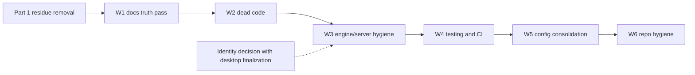

# Blazor Decommission + Whole-Codebase Cleanup

> **Status:** Plan / For Review
> **Date:** 2026-10-24
> **Scope:** finish the Blazor → SvelteKit transition and audit the repository for cleanup.
> **Related:** [`sveltekit-migration.md`](sveltekit-migration.md), [`game-client-unification-plan.md`](game-client-unification-plan.md), [`web-client-architecture.md`](web-client-architecture.md)

---

## 1. Where the migration actually stands

Phase 6 already deleted the Blazor applications. Verified in the current tree:

- gone: `Veldrath.Web`, `RealmFoundry`, `Veldrath.Auth.Blazor`, `Veldrath.GameClient.Components` (and their test projects, `.slnx` files, CI workflow, MudBlazor/bunit packages);
- the desktop host is now [`DesktopUiServer`](../Veldrath.Client/HostedWeb/DesktopUiServer.cs), which serves the static Svelte build and proxies `/api` + `/hubs` with an injected JWT;
- the only surviving `Blazor`/`MudBlazor` code in the repo lives in an orphan folder: `scripts/dev/blazor/`.

So the remaining work is **residue removal (no behaviour risk)** plus **one real architectural decision** (ASP.NET Core Identity), not a migration.

---

## 2. Part 1 — Blazor residue removal

| Artifact | Detail | Action |
|---|---|---|
| `scripts/dev/blazor/` | 19 orphan files: 18 `.razor` snapshots of deleted pages plus `VeldrathTheme.cs` (MudBlazor theme) and 5 CSS copies. Nothing references the folder. | Delete. Git history keeps it. |
| [`Veldrath.Client.csproj:47`](../Veldrath.Client/Veldrath.Client.csproj:47) | Comment `Embedded WebView2 for Blazor game UI hosting` | Reword to "hosts the Svelte desktop build". |
| [`RealmForge/README.md`](../RealmForge/README.md) | Claims `.NET MAUI Blazor Hybrid` / "Why Blazor Hybrid?" — the app is Avalonia + ReactiveUI. | Rewrite (tech stack, run commands, what it edits). |
| [`docs/design-system.md`](../docs/design-system.md) | MudBlazor-only content: §5.5 spacing delegation, MudBlazor token map in §8.2, RealmFoundry tables (§3.1, §7.8), §8.3, §8.4, §8.5 migration notes. | Move to a single appendix "Retired surfaces (Blazor/MudBlazor)" at the end; keep Avalonia + SvelteKit sections as the live reference. |
| [`web/shared/db/README.md`](../web/shared/db/README.md:41) | Section "Why this is safe on the existing Blazor database" | Reword to "the existing Postgres database". |
| `wiki/` (submodule) | `Foundry-Overview.md` describes a Blazor Server app; `Home.md`, `_Sidebar.md`, `Engine-Implementation-Status.md` list RealmFoundry / `Veldrath.Auth.Blazor` / Caddy. | Rewrite `Foundry-Overview.md` as the `/foundry` route group doc, fix Home/Sidebar/Implementation-Status. Separate commit inside the submodule. |
| `plans/` (23 files) | Historical designs: the 19 Blazor-era plans, the two superseded rendering plans, `reactive-ui-pivot-plan`, and `sveltekit-phase0`. | **Delete them.** First extract what is still true: the panel-driven UI and map-graph decisions moved to [`docs/client-ui-architecture.md`](../docs/client-ui-architecture.md); everything else is already covered by `docs/` and the agent memory. `plans/` keeps only `blazor-decommission-and-cleanup.md`, `sveltekit-migration.md`, and a short `README.md`. |
| [`docs/deployment.md`](../docs/deployment.md:180) | "The old Blazor `Veldrath.Web` and `RealmFoundry` containers … are retired." | Keep — accurate history. |

Acceptance: `grep -ril "blazor\|mudblazor"` (excluding `node_modules`, `bin`, `obj`, `.vs`, `web/llms`, build output) returns only intended mentions: the design-system appendix, the deployment history note, agent-memory session logs, and historical port comments.

---

## 3. Part 2 — The one real decision: ASP.NET Core Identity

Identity (not Blazor) is what still ties the old world to the new one:

- `PlayerAccount : IdentityUser<Guid>` is the game account row (characters, RBAC, moderation, bans).
- `/api/auth/{register,login,refresh,renew-jwt,logout,exchange,external/*,session}` exists for the **desktop client's native sign-in**.
- [`InternalAccountBridgeEndpoints`](../Veldrath.Server/Features/Auth/InternalAccountBridgeEndpoints.cs) + [`foundry-bridge.ts`](../web/client/src/lib/server/foundry-bridge.ts) + [`hooks.server.ts`](../web/client/src/hooks.server.ts) mirror Better Auth accounts into Identity (name/email/verification/password, provider links).

| Option | What changes | Cost / risk | When it makes sense |
|---|---|---|---|
| **1. Keep Identity as the account store (recommended)** | No deletion. Optionally shrink the bridge to one-way JIT provisioning and drop the password mirror once the desktop signs in through the web. | None now | Immediately — unblocks shipping, keeps desktop native sign-in working |
| **2. Retire Identity *auth* endpoints, keep Identity *tables* | Delete `/api/auth/{login,register,refresh,renew-jwt,external/*,session}` and `AuthService` token issuance; desktop signs in via Better Auth (browser/deep-link + exchange code). Identity tables stay for RBAC/characters. | Medium: needs desktop auth UX + deep-link handling; touches `AuthEndpoints`, `ExternalAuthEndpoints`, `SessionEndpoints`, `Veldrath.Auth` | After the desktop shell decision (full-window Svelte or native chrome) |
| **3. Remove Identity entirely** | `PlayerAccount` becomes a plain entity; roles/permissions move to first-class tables; password migration for remaining Identity-only accounts; drop cookies, DataProtection keys, `AspNetUserLogins`, `Identity` stores. | Large: schema + migration + every `UserManager`/`RoleManager` call site | Only after 2 has been live for a while |

Recommendation: **Option 1 now, decide 2 together with the desktop finalization**, and treat 3 as a separate future project. Nothing in Part 1 depends on it.

---

## 4. Part 3 — Whole-codebase cleanup workstreams

Ordered by risk/return. Each item is a single reviewable PR.

### W1 — Documentation truth pass (low risk, high value)
- Reconcile [`AGENTS.md`](../AGENTS.md), [`README.md`](../README.md), [`web/README.md`](../web/README.md), [`web/client/README.md`](../web/client/README.md), `wiki/`, `docs/design-system.md` with the current tree (ports 8080/8081/8083, `#lib`, `$app/env`, `#lib/server/env.ts`, no Caddy, no compose in Coolify).
- Add `plans/README.md`: index every plan with `active` / `superseded` / `archived` + one-line purpose. This alone stops future agents from following dead designs.
- Make `docs/coolify-deployment.md` the single deployment reference; `docs/deployment.md` becomes the overview that links to it.

### W2 — Dead code and unused references
- `Veldrath.Contracts`: enumerate consumers (client/server/tests) and delete DTOs no endpoint returns.
- `Veldrath.GameClient.Core`: now desktop-only — confirm no server/web references, then decide whether `IGameApiClient` (unimplemented in .NET now?) is still needed.
- `Veldrath.Auth`: confirm the desktop-only surface.
- Duplicate payload definitions: `Veldrath.GameClient.Core/Payloads/*` vs `web/client/src/lib/game/types.ts` — document the two-runner split or generate the TS types from the C# records with a small script.
- `[Obsolete] StartingSpellIds` in [`CharacterClass`](../RealmEngine.Shared/Models/CharacterClass.cs:137): remove or migrate usages.
- Web server duplication: every module that hand-rolls `fetch` should go through `#lib/server/game-request.ts` (`game-api.ts` already does; check `editorial-api.ts`, `content-api.ts`, `admin-api.ts`, `foundry-api.ts`, `character-api.ts`).

### W3 — Engine/server hygiene
- XML doc gaps flagged as P4 in [`.github/agent-memory/engine-codebase.md`](../.github/agent-memory/engine-codebase.md) — close them or move to "won't fix".
- Review `RealmEngine.Core` handler quirks listed in the memory file and either fix or document at the call site.
- `Program.cs` is ~730 lines: extract auth, CORS, email, SignalR, and startup seeding into extension methods (`AddVeldrathAuth`, `AddVeldrathCors`, …). Pure refactor, no behaviour change.

### W4 — Testing and CI
- Consolidate `FakeXxx` stubs; delete stubs with no consumers.
- Add a coverage floor per component in CI (engine/server/client/web) so regressions are visible.
- Add a markdown link check and `dotnet format --verify-no-changes` to CI.
- Web: extend Playwright to cover the authenticated `/characters` → `/play` path with a seeded account (currently only guards are covered).

### W5 — Configuration and deploy consolidation
- One source of truth for public URLs/ports: `docker-compose*.yml`, `.env.example`, `web/client/.env.example`, and the two deploy docs (now consistent after the env audit — verify with a scripted cross-check).
- Decide the fate of `docker-compose.api.yml` and `docker-compose.debugging.yml` (both still reference the old API-only/dev-debug flows) and of `deploy.yml`/GHCR jobs that publish images Coolify does not consume.
- Add a `scripts/check-env-docs.mjs`-style guard that fails CI when a documented env var is not read by code (or vice versa).

### W6 — Repository hygiene
- Remove `scripts/dev/blazor/` (Part 1) and any other orphan scratch folders.
- Re-check `.gitignore` / `.dockerignore` after the file moves (`client/build-desktop`, `SvelteApp/`, `.env`).
- Review `web/llms/` size (~5 MB of vendored docs) and whether it should stay in-repo.

---

## 5. Sequencing

**Acceptance for the whole effort**
1. `rg -i blazor` outside `plans/`, `web/llms/`, and the design-system appendix finds nothing.
2. `dotnet build Realm.Full.slnx`, the 10 .NET test projects, and `cd web && npm run typecheck && npm run lint && npm run test && npm run build` all pass after every PR.
3. `plans/` contains only live plans plus a short `README.md`; no document references a deleted project or plan.
4. No documentation tells a reader to run a command that no longer exists.

---

## 6. Progress log

| Step | Status | Commit |
|---|---|---|
| Part 1 — residue removal, plan pruning, design-system appendix, wiki, READMEs | ✅ Done | `33ac36ab`, `ebc70430` |
| W1 — documentation truth pass (AGENTS/README/CONTRIBUTING, dangling skill + instruction links) | ✅ Done | `ebc70430` |
| W2 — dead code (contracts audit, `editorial-api` → `gameApiFetch`) | ✅ Done | `5684f0d9` |
| W3 — engine/server hygiene | 🟡 Started: CORS policy extracted to `Infrastructure/CorsSetup.cs` (policy name is now a constant). Remaining: JWT/auth registration extraction, P4 XML doc gaps, obsolete `StartingSpellIds`. | `456ad367` |
| W4 — testing/CI (stub consolidation, coverage floors, markdown link check, authenticated Playwright path) | ⏳ Not started | — |
| W5 — config consolidation | 🟡 Workflows done: obsolete SSH deploy path removed (`deploy.yml` + the three `if: false` deploy jobs), `docs.yml` now watches `**/*.cs` instead of a hand-maintained project list, engine CI moved to `ubuntu-latest`, Dependabot gained a `/web` Dockerfile entry. Remaining: the compose-file decision below. | workflow cleanup commit |
| W6 — repository hygiene | ✅ Done: `.gitignore` already covers `/scripts/dev/`, `.env*`, `build-desktop/`, and packaged asset zips; `.dockerignore` verified (bin/obj, secrets, TestResults, IDE dirs, `client/build-desktop`). Remaining judgement call is `web/llms/` size. | — |

W2 findings worth keeping: of the 130 types in `Veldrath.Contracts`, only
`TravelToNodeResultDto` was genuinely dead (removed). `ContentTypeSchema`,
`ContentFieldGroup`, and `ContentFieldType` look unreferenced to a naive grep but are the return
types of `ContentSchemaRegistry`, which RealmForge and `ContentEndpoints` use — do not delete them.
`Veldrath.Auth` is used only by `Veldrath.Client` and its tests, which matches the Identity
decision below. The C# `Veldrath.GameClient.Core/Payloads/*` records and the TypeScript
`web/client/src/lib/game/types.ts` stay duplicated by design (two runtimes); change both in the
same PR rather than generating one from the other.

## 7. Decisions locked

1. **`scripts/dev/blazor/`** — deleted (it was untracked, so nothing needed committing).
2. **Plans** — delete finished/superseded plans; keep only `blazor-decommission-and-cleanup.md`,
   `sveltekit-migration.md`, and a short `README.md`. Durable decisions were extracted first into
   [`docs/client-ui-architecture.md`](../docs/client-ui-architecture.md) (the only unique knowledge
   in the deleted set: panel-driven UI and the DB map graph).
3. **Identity** — Option 1 (keep ASP.NET Core Identity) until the desktop shell decision; Option 2 is
   revisited together with desktop finalization, Option 3 only after that.
4. **Scope** — full W1–W6 sweep, executed in order, Part 1 as its own commit.
5. **`docker-compose.api.yml` / `docker-compose.debugging.yml`** — still open; decided in W5.

## 7. Open questions

1. **`docker-compose.api.yml` / `docker-compose.debugging.yml`** — keep for local API debugging, or
   delete as unused?
2. **`web/llms/`** (~5 MB of vendored upstream docs) — keep in-repo or move to a release artifact?
3. **`Veldrath.Contracts`** — do internal DTOs stay there, or move next to their feature slices?
