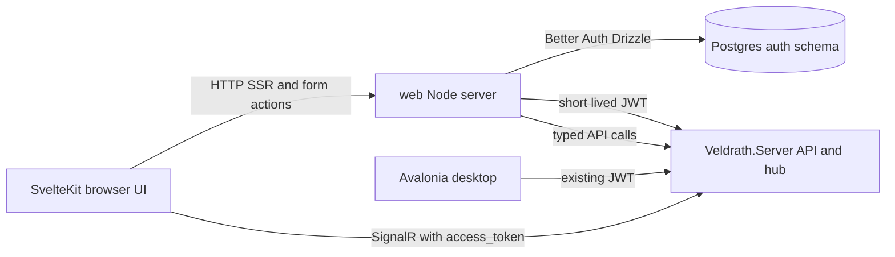

# SvelteKit Migration Plan

## Status

Phase 0 is complete and verified on the existing Blazor Postgres database:

- The template moved to `web/`; Colyseus, the TypeScript engine, the ticket helper, and the room schema were removed.
- Better Auth owns the `auth` schema; `auth.user`, `auth.session`, `auth.account`, `auth.verification`, and `auth.__drizzle_migrations` exist.
- The SvelteKit server mints a JWT that `Veldrath.Server` accepts.
- `/api/characters` returns `200` with the minted token, `/hubs/game/negotiate` returns `200`, and a real WebSocket connection receives `ServerInfo`.
- `npm run typecheck`, `npm run lint`, `npm run build`, and `npm run test` pass.
- Discord, Google, and Microsoft social providers are configured and Discord login is confirmed working.

Phase 1 is in progress. The .NET auth bridge is complete and verified:

- [`JwtClaimsEnrichment`](../Veldrath.Server/Features/Auth/JwtClaimsEnrichment.cs) runs on `JwtBearerEvents.OnTokenValidated` and enriches identity-only SvelteKit tokens with Identity role and `permission` claims.
- [`AccountProvisioningService`](../Veldrath.Server/Features/Auth/AccountProvisioningService.cs) provisions a `PlayerAccount` for an unknown `sub` GUID on first use, using the Better Auth username/email claims. Account-access snapshots are cached for 60 seconds per account.
- [`RolePermissionResolver`](../Veldrath.Server/Features/Auth/RolePermissionResolver.cs) is shared by token issuance and inbound enrichment so both paths derive RBAC claims identically.
- The SvelteKit game token now includes `email` and `email_verified` claims.
- Live verification: a Better Auth user with no `AspNetUsers` row received `200` from `/api/characters`; the row was created with the token GUID, username, and email; repeat requests did not duplicate it; `/hubs/game/negotiate` returned `200`.
- `Veldrath.Server.Tests` passes (771 tests, including 8 new provisioning/enrichment tests).

Remaining Phase 1 work: the temporary Foundry account bridge, OAuth redirect updates, existing-user/password migration, and the first game vertical slice.

## Decision

Replace the Blazor frontends with a **single SvelteKit application** using route groups, built from the in-repo [`Veldrath.Web.Sveltekit`](../Veldrath.Web.Sveltekit/TEMPLATE-GUIDE.md) workspace.

- The SvelteKit app becomes the only web frontend: public site, auth pages, game client, Foundry, admin, moderation, and editorial.
- The `Veldrath.Server` .NET app remains the API and SignalR hub. It is not rewritten.
- Better Auth owns web credentials and sessions and connects directly to Postgres for auth tables.
- SvelteKit mints short-lived JWTs for the .NET API and hub, so the existing JWT bearer validation and authorization policies keep working.
- Colyseus is removed from the template. The TypeScript `engine/` workspace is removed because the real engine is `RealmEngine.Core`.
- No Caddy in the target stack. The SvelteKit Node server and .NET server are exposed through the hosting platform proxy.
- RealmFoundry is migrated into the same SvelteKit app. Blazor Foundry stays running only during the transition.
- The Avalonia desktop client stays as-is initially. Its embedded Blazor host is replaced with the Svelte build in a later phase.

## Template review

The template provides:

- npm workspaces: `shared`, `engine`, `server`, `client`
- SvelteKit 2 with Svelte 5 runes and Vite 7
- `@sveltejs/adapter-node`
- Tailwind 4, Skeleton v5, Bits UI, Lucide, Simple Icons
- Better Auth and Drizzle ORM
- Vitest and Playwright
- ESLint and Prettier
- Docker multi-stage builds and a GitHub Actions workflow

What is not usable as-is:

- `server/` is a Colyseus server and must be removed.
- `engine/` is a TypeScript domain engine and must be removed.
- `shared/src/ticket.ts` and `shared/src/schema/` are Colyseus-specific and must be removed.
- `llms/colyseus/` is no longer relevant.
- The template's `AGENTS.md` references `client/src/lib/server/auth.ts`, `client/src/hooks.server.ts`, and `client/src/app.d.ts`, but those files do not exist in the checked-in scaffold. Better Auth is declared but not wired.
- The `auth:schema` script points at the missing `src/lib/server/auth.ts`.
- `package.json` declares `better-auth` as `^1.6.23`, while `package-lock.json` resolves 1.7.1. Pin a single version.
- Placeholders remain: `your-project`, `@your-scope`, and the `app` theme.

## Target repository layout

```text
.
├── web/                              # new JS workspace, moved from Veldrath.Web.Sveltekit
│   ├── package.json                  # workspaces: ["shared", "client"]
│   ├── package-lock.json
│   ├── tsconfig.base.json
│   ├── shared/                       # @veldrath/shared
│   │   ├── src/db/auth.schema.ts     # Better Auth tables
│   │   ├── src/db/schema.ts
│   │   ├── src/contracts/            # generated TS from .NET
│   │   └── drizzle.config.ts
│   ├── client/                       # SvelteKit app
│   │   ├── src/routes/
│   │   ├── src/lib/server/auth.ts
│   │   ├── src/lib/server/game-token.ts
│   │   ├── src/hooks.server.ts
│   │   ├── src/app.d.ts
│   │   └── static/
│   └── Dockerfile
├── Veldrath.Server/                  # unchanged API + hub
├── Veldrath.Client/                  # Avalonia desktop, embedded host replaced later
├── RealmFoundry/                     # temporary Blazor app
├── RealmForge/                       # Avalonia DB editor, unchanged
├── Veldrath.Discord/                 # unchanged
├── RealmEngine.Core/                 # unchanged
├── RealmEngine.Data/                 # unchanged
├── RealmEngine.Shared/               # unchanged
└── ...
```

`web/` is deliberately outside the .NET solution files. The .NET and Node builds stay independent.

## Runtime architecture



- Public pages and Foundry pages use SvelteKit SSR.
- The game pages use client-side rendering behind an auth guard.
- REST calls that need secrets or cookie-bound sessions go through SvelteKit server routes.
- The SignalR connection goes directly from the browser to `Veldrath.Server` with a short-lived token, because proxying WebSockets through adapter-node is unnecessary and adds complexity.

## Auth architecture

This is the critical part of the migration.

### Ownership split

| Concern | Owner |
|---|---|
| Web credentials, email verification, password reset, OAuth | Better Auth in `web/client` |
| Web session cookie | Better Auth |
| Game account row, moderation state, character ownership | `Veldrath.Server` |
| Roles and fine-grained permissions | `Veldrath.Server` initially |
| API and hub authentication | Existing .NET JWT bearer |

### Account identity

- Better Auth `user.id` is the canonical account identifier.
- Existing `AspNetUsers.Id` GUIDs are preserved when importing users into Better Auth. `user.id` is the GUID string.
- New registrations use a GUID generated by Better Auth. Keep the GUID generator configurable so it matches the .NET `Guid` type.
- .NET provisions a matching `PlayerAccount` row on first authenticated request if one does not exist. This avoids cross-service registration transactions.
- `PlayerAccount` remains the game profile and moderation row. It may continue to inherit `IdentityUser<Guid>` during the transition; decoupling it from ASP.NET Identity can happen after Blazor is gone.

### Game token

SvelteKit mints an HS256 JWT using `jose`:

- `sub` = Better Auth user ID, which is the game account GUID
- `name` = username
- `iss` = `Jwt:Issuer`
- `aud` = `Jwt:Audience`
- short expiry
- signed with the same `Jwt:Key` the .NET server already validates

The browser uses that token for SignalR through `accessTokenFactory`. SvelteKit server routes attach a fresh token to server-side API calls.

### Roles and permissions

- Phase 1 keeps the existing .NET RBAC as the source of truth.
- Add an `IClaimsTransformation` in `Veldrath.Server` that loads roles and role/user permissions for the `sub` account and adds `role` and `permission` claims. Cache the result briefly to avoid a database hit per request.
- Add a small `GET /api/auth/game-session` endpoint that returns the enriched roles and permissions for the current token. SvelteKit uses it for UI route guards.
- Later, if Better Auth's admin plugin becomes the role source, the claims transformation can be simplified. Do not duplicate RBAC in both systems during the first cutover.

### Existing account migration

- Import `AspNetUsers` rows into Better Auth `user` with the same GUID.
- Import `AspNetUserLogins` rows into Better Auth `account` rows using provider IDs `discord`, `google`, and `microsoft`.
- Set `emailVerified` from `EmailConfirmed`.
- Migrate passwords with a one-time Node script:
  - Read `AspNetUsers.PasswordHash`.
  - Verify the ASP.NET Identity PBKDF2 format.
  - Write a Better Auth-compatible scrypt hash into `account.password`.
  - Report any accounts that fail verification and fall back to a forced password reset for those only.
- Do not delete `AspNetUsers` during the transition. Blazor Foundry and the desktop client still depend on it.

### Temporary account bridge for Blazor Foundry

While RealmFoundry is still Blazor:

- Keep the .NET `/api/auth/login`, `/api/auth/renew-jwt`, `/api/auth/external/*`, and `/api/auth/session` endpoints.
- On Better Auth registration and password change, call a temporary .NET internal endpoint to create or update the matching `PlayerAccount` password hash. This keeps Blazor Foundry login working for users created through the SvelteKit site.
- Remove this bridge when the Foundry routes move into SvelteKit and the Blazor app is deleted.

### Better Auth database

- Put Better Auth tables in a dedicated Postgres schema, for example `auth`.
- Drizzle owns only the `auth` schema. EF Core owns the public game tables.
- Use a separate database role for the SvelteKit auth connection with privileges limited to the `auth` schema.
- Keep the Drizzle client lazy so `vite build` does not require a database connection.
- Verify whether the Better Auth Drizzle adapter supports namespaced schemas directly. If not, use prefixed table names and Better Auth `modelName` overrides.

### OAuth

- Move Discord, Google, and Microsoft OAuth to Better Auth.
- Update provider redirect URIs from `api.veldrath.com/api/auth/external/callback` to `veldrath.com/api/auth/callback/{provider}`.
- Use Better Auth's account-linking behavior for matching emails. Document any behavior change from the current pending-link email flow.
- Keep the .NET OAuth endpoints only for the Blazor Foundry and desktop transition.

## Route groups

```text
web/client/src/routes/
├── +layout.svelte
├── +layout.server.ts                 # session and user locals
├── +page.svelte                      # home
├── (auth)/
│   ├── login/
│   ├── register/
│   ├── forgot-password/
│   ├── reset-password/
│   └── confirm-email/
├── (site)/
│   ├── community/
│   ├── lore/
│   ├── lore/[slug]/
│   ├── patch-notes/
│   ├── patch-notes/[slug]/
│   └── account/profile/
├── (game)/
│   ├── game/
│   ├── game/character-select/
│   ├── game/create-character/
│   ├── game/play/
│   └── game/settings/
├── (foundry)/
│   ├── submissions/
│   ├── submissions/new/
│   ├── submissions/[id]/
│   ├── notifications/
│   ├── content/
│   ├── content/[type]/
│   ├── content/[type]/[slug]/
│   ├── languages/
│   ├── languages/new/
│   └── players/[id]/
├── (admin)/
│   ├── admin/
│   ├── admin/users/
│   ├── admin/users/[id]/
│   ├── admin/roles/
│   ├── admin/sessions/
│   ├── admin/audit/
│   ├── admin/reports/
│   ├── admin/status/
│   └── admin/server/
├── (mod)/
│   ├── mod/
│   ├── mod/reports/
│   ├── mod/users/
│   └── mod/users/[id]/
├── (editorial)/
│   ├── editorial/patch-notes/
│   ├── editorial/lore/
│   └── editorial/announcements/
└── api/
    ├── auth/[...all]/+server.ts      # Better Auth handler
    └── game-token/+server.ts         # mint short-lived .NET JWT
```

Guard rules:

- `(game)`, `(foundry)` write routes, and `(site)/account` require a Better Auth session.
- `(admin)` requires `admin.users` or `admin.roles`.
- `(mod)` requires moderation permissions.
- `(editorial)` requires `content.manage`.
- Guards are UX only. The .NET API remains the authorization boundary.

## Phases

### Phase 0 — Workspace foundation

- Move `Veldrath.Web.Sveltekit` to `web/`.
- Delete `web/server/`, `web/engine/`, `web/llms/colyseus/`, `shared/src/ticket.ts`, and `shared/src/schema/`.
- Reduce the root workspace list to `shared` and `client`.
- Rename packages from `@your-scope/*` to `@veldrath/*`, rename the root package, and rename the `app` theme.
- Scaffold the missing Better Auth files: `client/src/lib/server/auth.ts`, `client/src/hooks.server.ts`, `client/src/app.d.ts`, and `client/src/routes/api/auth/[...all]/+server.ts`.
- Configure Drizzle for the `auth` schema and generate the initial migration.
- Add `jose` and the game-token endpoint.
- Add `.gitignore` entries for `node_modules`, `.svelte-kit`, `build`, `test-results`, and `playwright-report`.
- Verify `npm run typecheck`, `npm run lint`, `npm run test`, and `npm run build`.

Exit criteria: Better Auth registration and login work against Postgres, a protected placeholder route redirects correctly, and the SvelteKit build is DB-free.

### Phase 1 — Auth bridge and first game slice

- ✅ Add the .NET CORS policy for the SvelteKit origin.
- ✅ Add the .NET claims transformation and JIT account provisioning
  (`JwtClaimsEnrichment`, `AccountProvisioningService`, `RolePermissionResolver`).
- Add the temporary internal account bridge for Blazor Foundry.
- Implement SvelteKit login, register, logout, session hooks, and game-token minting.
- Update OAuth redirect URIs and migrate existing users, logins, and passwords.
- Port one vertical slice: login, character select, enter zone, map graph, travel, and inventory overlay.
- Connect SignalR directly with a short-lived token.

Exit criteria: a real character can log in through Better Auth, enter a zone, travel, and open the inventory in SvelteKit. The .NET API and hub accept the SvelteKit-issued token.

### Phase 2 — Game client parity

- Port the game shell, header, footer, sidebars, map, detail panel, combat, chat, all overlays, settings, and reconnect behavior.
- Port `CardinalGraphLayout` to TypeScript with its tests.
- Group the hub handlers into stores: session, character, zone/map, combat, inventory/shop, chat/social, moderation.
- Reuse `tokens.css` and `game.css`, adapted to the SvelteKit layout.
- Add Playwright flows for character creation, travel, combat, shop, inventory, and reconnect.

Exit criteria: the SvelteKit game UI replaces the Blazor game routes, and the RCL is no longer used by the web app.

### Phase 3 — Public site and account pages

- Port home, community, lore index and detail, patch notes index and detail, login, register, forgot password, reset password, confirm email, and account profile.
- Use SvelteKit server loads for SSR and SEO.
- Remove the corresponding Blazor pages from `Veldrath.Web`.

Exit criteria: the public site is fully served by SvelteKit and the Blazor web app has no remaining public routes.

### Phase 4 — Foundry, admin, moderation, editorial

- Port the 35 Foundry route declarations into the `(foundry)`, `(admin)`, `(mod)`, and `(editorial)` groups.
- Replace MudBlazor tables, selects, text fields, dialogs, and forms with Skeleton and Bits UI components.
- Replace Markdig and HtmlSanitizer with `marked` and DOMPurify. Keep server-side sanitization on write.
- Replace `RealmFoundryApiClient` with typed API client modules.
- Add role-based layout guards and Playwright coverage for submission review, user management, moderation, and editorial CRUD.

Exit criteria: RealmFoundry Blazor can be retired.

### Phase 5 — Desktop

- Replace `HostedGameServer` and `EmbeddedApp` with a static Svelte build served by the Avalonia WebView2 shell.
- Add a local token bridge that reuses the desktop authentication result.
- Keep the native Avalonia fallback until the WebView path is stable.
- Defer Tauri unless the Avalonia shell becomes a limitation.

Exit criteria: the desktop client runs the Svelte UI, and the Razor Class Library is no longer referenced.

### Phase 6 — Decommission and cleanup

- Delete `Veldrath.Web`, `RealmFoundry`'s Blazor host, `Veldrath.Auth.Blazor`, `Veldrath.GameClient.Components`, `Veldrath.Web.Tests`, and `RealmFoundry.Tests`.
- Remove the old .NET auth endpoints after the desktop and Foundry no longer need them.
- Remove `Caddyfile`, the old web service, and obsolete compose entries.
- Update all `.slnx` files, CI workflows, VS Code tasks, `AGENTS.md`, memory files, and documentation.
- Run the full .NET test suite and the full SvelteKit test suite.

## Repository and tooling changes

- Add `web/` to the root documentation and agent instructions. Create a `web/AGENTS.md` adapted from the template.
- Update `.gitignore` for Node artifacts and keep `.env.example` files tracked.
- Replace the `run-veldrath-web` VS Code task with `web:dev`, `web:build`, `web:test`, and a compound server plus web task.
- Replace `ci-web.yml` with a Node workflow that runs install, typecheck, lint, Vitest, Playwright, build, and Docker packaging.
- Replace the `web` service in `docker-compose.yml` and `docker-compose.prod.yml` with the SvelteKit Node image.
- Remove the Caddy service after the old stack is retired. TLS and routing are handled by the hosting platform.
- Keep the .NET server CORS policy restricted to the known web origins.
- Keep `versions/web.props` only until the old .NET web app is deleted.

## Testing strategy

- Vitest: API clients, auth helpers, game stores, map layout, and component behavior.
- Playwright: auth, character creation, game loop, shop, inventory, combat, Foundry submission and review, admin role guards, and editorial CRUD.
- Contract generation: generate TypeScript from the .NET OpenAPI document and fail CI on drift.
- SignalR payloads: generate or verify TypeScript event types against `Veldrath.GameClient.Core/Payloads`.
- .NET: add tests for SvelteKit-issued JWTs, claims transformation, JIT provisioning, and CORS.
- Keep the existing .NET test suite intact until the corresponding Blazor projects are deleted.

## Risks

| Risk | Impact | Mitigation |
|---|---|---|
| Better Auth and ASP.NET Identity diverge | High | Shared GUID, JIT provisioning, temporary password bridge, one-time migration script |
| Password hash migration fails | High | Script with dry run and per-account fallback to password reset |
| SignalR auth or CORS breaks | High | Direct hub connection with short-lived token; integration test before UI port |
| Better Auth table naming collides | Medium | Dedicated `auth` schema or prefixed table names; verify adapter support in Phase 0 |
| Blazor Foundry cannot authenticate Better Auth users | High during transition | Temporary password/account bridge; migrate Foundry before removing .NET auth endpoints |
| Route guards are bypassed | High | Server-side layout guards plus .NET API authorization; never rely on client checks |
| Markdown sanitization regressions | Medium | `marked` plus DOMPurify; keep server-side sanitization on write |
| Node runtime and dependency operations | Medium | Pinned versions, lockfile, CI audit, Docker image rebuilds |
| Desktop divergence | Medium | Keep the Svelte UI embeddable; defer the shell decision |
| Dual maintenance during migration | Medium | Time-box Blazor to critical fixes; migrate route by route |

## Immediate next step

Start Phase 0 with a narrow vertical slice:

1. Move the template into `web/` and remove Colyseus and the TypeScript engine.
2. Scaffold Better Auth, Drizzle, and the missing SvelteKit server files.
3. Prove Better Auth login against Postgres.
4. Prove SvelteKit can mint a token that `Veldrath.Server` accepts.
5. Prove the browser can open a SignalR connection and receive one event.
6. Only then port character select and the map.

That sequence validates the three hard parts — auth, token compatibility, and real-time connectivity — before any large UI port begins.
