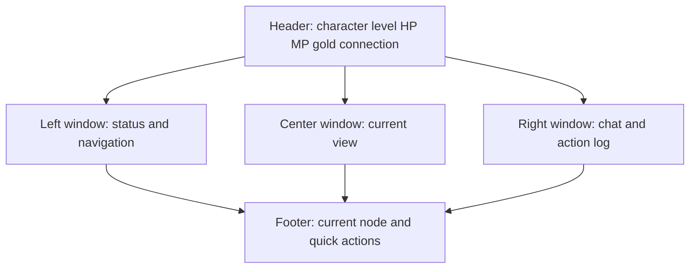

# Text Dashboard + Unified Map Graph Plan

> **Date:** 2026-10-21
> **Status:** Proposed — awaiting approval
> **Scope:** RCL in-game screens in `Veldrath.GameClient.Components`; replaces tilemaps/TMX with a DB-backed node graph.
> **Supersedes:** the tilemap-first portions of `plans/gameplay-view-refactor-plan.md` and `plans/map-view-refactor-plan.md`.

---

## 1. Locked decisions

| Decision | Choice |
|---|---|
| Visual language | **Level A — text-first dashboard**: MudBlazor panels, tables, lists, CSS node cards, orthogonal connectors, Material icons, restrained color, optional thin stat bars |
| UI surface | **RCL only** (`Veldrath.GameClient.Components`), in-game screens first |
| Map model | **Unified DB graph**: `Map`, `MapNode`, `MapEdge` |
| Map ownership | **`ContentDbContext`**, alongside `ZoneLocation`, using soft references to Region/Zone slugs |
| Entry/exit | **Explicit nodes**: `EntryPoint`, `ZoneExit`, `RegionExit`, `Portal`, `Stair`; exit nodes carry `TargetMapId` / `TargetNodeId` |
| Cardinality | Edges are strictly `N`, `S`, `E`, `W`, plus `Up`, `Down`, `In`, `Out` where needed |
| Source of truth | **Database**; JSON is not a runtime map source |
| TMX migration | **One-time importer** reads existing TMX + `ZoneLocation` data, writes the graph, verifies it, then the TMX layer is deleted |
| First-slice screens | Game shell, header/footer/sidebars, combat, map, inventory, shop, journal, character sheet |
| Deferred | Character Select, Create Character, Game Entry, Settings redesign; native Avalonia game views; RealmForge map editor |

---

## 2. What “text-based” means

1. **Content primitives only**: prose, lists, tables, key-value rows, logs, badges, separators.
2. **Docked text windows**: title bar + bordered body; no draggable OS windows.
3. **Map is a cardinal node graph**: nodes on a logical grid, horizontal/vertical edges, no diagonals, no tile movement.
4. **List-driven interaction**: every action is a labeled button or row; no click-anywhere spatial input.
5. **Icons only**: Material icons via `MudIcon`; no structural emoji, images, sprites, tilemaps, or canvas.
6. **Text-first status**: numbers carry the meaning; color is an accent; thin bars optional.
7. **Responsive and keyboard-usable**: side panels collapse to tabs; lists and map nodes are keyboard reachable.

---

## 3. Current-state findings

### UI

- [`Game.razor`](../Veldrath.GameClient.Components/Components/Pages/Game.razor:13) is a 3-column shell: left sidebar, center tilemap/location panel, right chat sidebar, plus header/footer.
- The center view is selected by `GameState.ZoneTileMap is not null` and renders [`GameTilemap.razor`](../Veldrath.GameClient.Components/Components/Pages/GameTilemap.razor:7) with `Tile`, `TileInfoCard`, and `TileStatusBar`.
- [`GameMap.razor`](../Veldrath.GameClient.Components/Components/Pages/GameMap.razor:53) renders zones as cards; it does not render edges.
- Overlays use grids/cards: [`InventoryOverlay.razor`](../Veldrath.GameClient.Components/Components/Shared/InventoryOverlay.razor:11), [`ShopOverlay.razor`](../Veldrath.GameClient.Components/Components/Shared/ShopOverlay.razor:12), [`JournalOverlay.razor`](../Veldrath.GameClient.Components/Components/Shared/JournalOverlay.razor:9), [`CharacterSheetOverlay.razor`](../Veldrath.GameClient.Components/Components/Shared/CharacterSheetOverlay.razor:7).
- Emoji are used as structural glyphs in several components.

### Data

- **TMX layer**: 22 `.tmx` files under `Veldrath.Assets/GameAssets/tilemaps/maps`; `ITileMapRepository` / `TiledFileMapRepository`; `TileMapDto` / `RegionMapDto`; tile movement and transitions in `MoveCharacter`, `MoveOnRegion`, `ExitZone`, `ChangeRegion`, `GetZoneTileMap`, `GetRegionMap`.
- **Location graph**: `ZoneLocation` has `TileX/TileY`; `ZoneLocationConnection` has `FromLocationSlug`, `ToLocationSlug?`, `ToZoneId?`, `ToRegionId?`, `ConnectionType`, `IsTraversable` — but no direction, label, repository, or hub payload.
- **Region graph**: `RegionConnection` is a directed edge with no direction or label.
- **No zone-to-zone edge table**: zone transitions only exist as TMX exit tiles or location-level `ToZoneId`.
- **Player position**: `PlayerSession.TileX/TileY`; `Character.TileX/TileY/TileZoneId` and `CurrentZoneLocationSlug`.
- **Tile-bound server systems**: `EnemyAiService`, `ZoneEntityTracker`, `MoveCharacter`, `MoveOnRegion`, and combat spawning all assume tile positions.

---

## 4. Target schema

All three graph entities live in `ContentDbContext`.

### 4.1 `Map`

| Field | Type | Notes |
|---|---|---|
| `Id` | string PK | Stable slug, e.g. `region:thornveil`, `zone:crestfall` |
| `MapType` | enum | `Region`, `Zone`; `World` reserved |
| `OwnerId` | string | Region or zone slug |
| `Name` | string | Display name |
| `Description` | string | Header text |
| `EntryNodeId` | string? | Default arrival node on this map |
| `IsActive` | bool | Content visibility |
| `Version` | int | Content version |
| `UpdatedAt` | DateTimeOffset | Audit |

### 4.2 `MapNode`

| Field | Type | Notes |
|---|---|---|
| `Id` | string PK | Stable slug, e.g. `crestfall:square` |
| `MapId` | string FK | Cascade delete |
| `NodeType` | enum | `EntryPoint`, `Zone`, `Location`, `ZoneExit`, `RegionExit`, `Portal`, `Stair`, `Landmark` |
| `RefId` | string? | Zone slug, location slug, or region slug |
| `DisplayName` | string | Node label |
| `Description` | string | Detail text |
| `IconKey` | string? | Material icon name |
| `LayoutX`, `LayoutY` | int? | Authored grid position; importer sets from TMX/tiles |
| `IsEntryPoint` | bool | Mirrors `Map.EntryNodeId` for querying |
| `IsExitPoint` | bool | True for exit-like nodes |
| `TargetMapId` | string? | Destination map for exit/portal nodes |
| `TargetNodeId` | string? | Destination node on the target map |
| `IsHidden` | bool | Map-specific visibility |
| `UnlockType`, `UnlockKey`, `DiscoverThreshold` | mixed | Mirrors existing discovery metadata where relevant |
| `SortOrder` | int | Stable list ordering |

### 4.3 `MapEdge`

| Field | Type | Notes |
|---|---|---|
| `Id` | Guid PK | |
| `MapId` | string FK | Cascade delete |
| `FromNodeId`, `ToNodeId` | string FK | Both must belong to `MapId`; no self-edges |
| `Direction` | enum | `North`, `South`, `East`, `West`, `Up`, `Down`, `In`, `Out` |
| `EdgeType` | enum | `Walk`, `ExitToZone`, `ExitToRegion`, `Portal`, `Door` |
| `Label` | string? | e.g. `East Road` |
| `IsTraversable` | bool | Default true |
| `IsHidden` | bool | Hidden until discovered |

### 4.4 Indexes and validation

- Unique `(MapId, OwnerId)` on `Map`.
- Unique `(MapId, FromNodeId, Direction)` on `MapEdge` — one edge per cardinal direction per node.
- Index `(MapId, ToNodeId)`.
- Check `FromNodeId != ToNodeId`.
- Validator checks:
  - `EntryNodeId` exists and belongs to the map.
  - Edge endpoints belong to the same map.
  - Exit nodes have `TargetMapId` and `TargetNodeId`.
  - Target map/node pairs exist.
  - Referenced region/zone/location slugs resolve (cross-context check at seed/startup).
  - No duplicate directions, no orphans, no disconnected required nodes.

### 4.5 Player position

Add to `Character` and `PlayerSession`:

- `CurrentMapId` (string?) — current region/zone map.
- `CurrentNodeId` (string?) — current node.

Keep `CurrentZoneId`, `CurrentZoneLocationSlug`, and `PlayerSession.ZoneId` for zone context, chat groups, and combat. Keep `TileX/TileY/TileZoneId` temporarily; remove after migration is verified.

---

## 5. Map semantics

### 5.1 Region map

- One `Map` per region.
- Nodes:
  - `EntryPoint` — where players arrive from another region.
  - `Zone` — one per zone in the region; `RefId` = zone slug.
  - `RegionExit` — one per adjacent region; `TargetMapId` = target region map, `TargetNodeId` = its entry node.
- Edges connect `EntryPoint`, `Zone`, and `RegionExit` nodes cardinally.

### 5.2 Zone map

- One `Map` per zone.
- Nodes:
  - `EntryPoint` — arrival node (default location or zone entrance).
  - `Location` — one per `ZoneLocation`; `RefId` = location slug.
  - `ZoneExit` — exits to another zone; `TargetMapId` = target zone map.
  - `RegionExit` — return to the region map; `TargetMapId` = region map.
  - `Portal` / `Stair` — special transitions.
- Edges connect locations and exits cardinally.

### 5.3 Transitions

- Intra-map travel: an edge from `CurrentNodeId` to the selected node.
- Map transition: the selected node is an exit with `TargetMapId` / `TargetNodeId`; the server moves the player to the target map/node.
- Region → Zone: travel to a `Zone` node on the region map.
- Zone → Region: travel to a `RegionExit` node.
- Zone → Zone: travel to a `ZoneExit` node.
- Region → Region: travel to a `RegionExit` node on the region map.

---

## 6. TMX importer

A one-time in-repo tool (not a runtime dependency) reads the existing TMX data and writes the graph.

### Inputs

- `TiledFileMapRepository` region/zone maps: `ZoneEntries`, `RegionExits`, `Paths`.
- `ZoneLocation` rows: `TileX/TileY`, names, types, traits.
- `ZoneLocationConnection` rows: walk/exit/region_exit edges.
- `RegionConnection` rows: region adjacency.
- `Zone` / `Region` catalog rows for display names and ownership.

### Output

- `Map` rows for every region and zone.
- `MapNode` rows:
  - Region maps: `EntryPoint`, `Zone` nodes, `RegionExit` nodes.
  - Zone maps: `EntryPoint`, `Location` nodes, `ZoneExit` / `RegionExit` nodes.
- `MapEdge` rows:
  - Region maps: edges derived from TMX `Paths`; connect nodes near path endpoints/points; fall back to nearest cardinal neighbor on the same row/column.
  - Zone maps: intra-zone `walk` connections → edges; direction computed from `TileX/TileY` deltas; exits → exit nodes with deterministic free-direction placement.
- `LayoutX/LayoutY` from TMX tile positions and `ZoneLocation.TileX/TileY`.
- A verification report: map/node/edge counts, orphans, duplicate directions, unresolved refs, missing targets, disconnected components.

### Reproducibility

- Run the importer against a developer database.
- Generate `MapGraphSeeder.cs` from the imported graph (explicit rows) and add it to `DatabaseSeeder`.
- Fresh databases then get the graph without TMX.
- The importer is retained as a dev-only utility until TMX is deleted; the generated seeder is the long-term source.

---

## 7. Server API

### Contracts

New `Veldrath.Contracts/Map/MapContracts.cs`:

- `MapSummaryDto`
- `MapGraphDto` — map metadata, entry node, nodes, edges.
- `MapNodeDto` — type, ref, name, description, icon, layout, flags, target map/node, discovered state.
- `MapEdgeDto` — endpoints, direction, edge type, label, traversable.
- `TravelResultDto` — success, current map/node, transitioned, message.

### Repository

- `IMapGraphRepository` in `RealmEngine.Shared/Abstractions`.
- `EfCoreMapGraphRepository` in `RealmEngine.Data/Repositories` using `ContentDbContext`.
- Methods: get map by id/owner, get map for region/zone, get node, get outgoing edges, get graph, validate.

### Hub commands

- `GetMapGraphHubCommand(mapId?)` — current map when omitted; returns the filtered graph for the character.
- `TravelToNodeHubCommand(characterId, mapId, nodeId)` — validates edge, requirements, and transitions; updates `Character` and `PlayerSession`; broadcasts `NodeTraveled` or `MapEntered`.
- Keep old hub methods as deprecated wrappers during migration, then remove.

### Server behavior

- Enemy rosters remain per location (`ZoneLocationEnemyStore` / `ActorPoolResolver`); entering a `Location` node ensures the roster.
- Passive discovery sweep runs on `Location` node arrival.
- Tile-based `EnemyAiService` is disabled for the node map; enemies do not roam between nodes in the first slice.
- `ZoneEntityTracker` remains only for zone presence/player lists until replaced by node presence.

---

## 8. Client core

- `IGameStateService` gains:
  - `CurrentMapId`, `CurrentNodeId`, `CurrentMapGraph`, `SelectedNodeId`.
  - `ApplyMapGraph`, `ApplyNodeTraveled`, `ApplyMapEntered`.
  - `TravelToNodeCommand` in the RCL uses `Hub.SendAsync("TravelToNode", ...)`.
- Remove tile state after migration:
  - `ZoneTileMap`, `PlayerTileX/PlayerTileY`, `RegionState.Tiles`, tile payloads, fog payloads, entity movement payloads.
- `EnemyInfo` / `OccupantInfo` lose tile coordinates when no longer needed; UI lists them by node/location.

---

## 9. UI architecture

### Shared components

- `TextPanel.razor` — title bar, action slot, bordered body.
- `StatRow.razor` / `StatTable.razor` — label/value rows; optional thin `MudProgressLinear`.
- `EntityList.razor` — icon + name + secondary text + action.
- `ItemTable.razor` — icon/name, type, qty, weight, value, actions.
- `DetailPane.razor` — selected item/quest/node details.
- `CardinalMap.razor` + `CardinalMap.razor.cs`.
- `CardinalGraphLayout.cs` — pure layout engine:
  - Places nodes on an integer grid.
  - Respects authored `LayoutX/LayoutY`; otherwise computes a deterministic layout.
  - Emits only horizontal/vertical edge segments; routes offsets with elbows.
  - Avoids node overlap; deterministic across runs.
- `MapDetailPanel.razor` — selected node name/description, exit rows (`N — Market`), travel action.

### Map interaction

- Single click selects a node; `Travel` in the detail pane performs the transition.
- Keyboard: arrow keys move selection along connected nodes; Enter travels; Esc closes.
- Current node highlighted with a text badge; undiscovered nodes show `?`.
- Narrow screens: map becomes a vertical node list grouped by direction; no horizontal scrolling required.

### Screen transformations

| Current | Target |
|---|---|
| `GameHeader` app bar | Compact text header: name, class, level, HP/MP text + thin bars, gold, connection icon |
| `GameFooter` | Current map/node, quick actions, connection status/ping |
| `LeftSidebar` | Status summary, navigation list, nearby players/enemies as lists |
| `RightSidebar` | Chat tabs and message list unchanged in structure; text-only |
| `GameTilemap` | Removed; center view becomes `CardinalMap` or a panel |
| `GameMap` zone cards | `CardinalMap` region view |
| `ZoneLocationPanel` | `MapDetailPanel` for the selected node |
| `GameCombat` | Enemy list with text HP, combat log, action buttons, ability list |
| `InventoryOverlay` | Equipment table + inventory table + detail pane |
| `ShopOverlay` | Merchant table + player items table + gold total |
| `JournalOverlay` | Active/completed quest table + detail pane + objectives table |
| `CharacterSheetOverlay` | Attributes/derived stats tables + equipment summary |
| `ActionBar` hotbar grid | Ability list/table with keybind text and icons |
| Emoji glyphs | `MudIcon` equivalents |

---

## 10. Removals after migration

- `Veldrath.Contracts/Tilemap/TilemapContracts.cs`.
- `ITileMapRepository`, `TiledFileMapRepository`, `TiledMap` map-specific models if unused.
- TMX files under `Veldrath.Assets/GameAssets/tilemaps` and tilemap manifests.
- `GetZoneTileMapHubCommand`, `GetRegionMapHubCommand`, `MoveOnRegionHubCommand`, `MoveCharacterHubCommand`, `ExitZoneHubCommand`, `ChangeRegionHubCommand` tile implementations.
- `EnemyAiService` tile movement and `ZoneEntityTracker` tile fields.
- RCL `GameTilemap`, `Tile`, `TileInfoCard`, `TileStatusBar` and tile CSS.
- Client `TilemapViewModel`, `RegionTilemapViewModel`, `MapViewModel`, `MapEdgeViewModel`, `TileDescriptionService` and native tile views.
- `PlayerSession.TileX/TileY` and `Character.TileX/TileY/TileZoneId` once verification is complete.

---

## 11. Implementation phases

### Phase 0 — Schema
- Add `Map`, `MapNode`, `MapEdge`, enums, EF configuration, migration.
- Add `CurrentMapId` / `CurrentNodeId` columns to `Character` and `PlayerSession`.
- Add contracts and DTOs.
- Add repository interface and EF implementation.
- Add validator + tests.

### Phase 1 — Import and seed
- Build `TmxToMapGraphImporter` and verification report.
- Run against a dev database.
- Generate `MapGraphSeeder.cs`; wire into `DatabaseSeeder`.
- Assert counts and validation in tests.
- Confirm a fresh database produces the same graph without TMX.

### Phase 2 — Server navigation
- Implement `GetMapGraph` and `TravelToNode` handlers.
- Add `NodeTraveled` / `MapEntered` payloads.
- Adapt discovery, enemy roster, and session updates.
- Add handler and integration tests.
- Keep old commands temporarily.

### Phase 3 — Client core
- Add map graph/current node state and apply methods.
- Add travel command wiring.
- Remove tile state from `GameStateService` and payload subscriptions.
- Add tests.

### Phase 4 — Text dashboard shell
- Add `TextPanel`, `StatRow`, `EntityList`, `ItemTable`, `DetailPane`.
- Rebuild `GameHeader`, `GameFooter`, `LeftSidebar`, `RightSidebar` as text windows.
- Add responsive collapse behavior.
- Add bUnit tests.

### Phase 5 — Cardinal map
- Implement `CardinalGraphLayout` with unit tests.
- Implement `CardinalMap` and `MapDetailPanel`.
- Replace `GameMap` and `GameTilemap` center views.
- Add selection, travel, keyboard, and empty/error states.
- Add bUnit tests.

### Phase 6 — In-game panels
- Convert combat to text lists/log.
- Convert inventory, shop, journal, and character sheet to tables/detail panes.
- Convert action bar/hotbar to a list.
- Replace emoji with icons.
- Add bUnit tests for each panel.

### Phase 7 — Removal and cleanup
- Delete TMX infrastructure, contracts, handlers, components, payloads, and assets.
- Remove tile fields and old hub methods.
- Clean tile CSS and unused tests.
- Update docs and agent memory; mark tilemap plans superseded.
- Run full build, full test suite, and runtime smoke tests.

### Phase 8 — Optional authoring
- RealmForge map graph editor for nodes/edges and validation.
- JSON import/export tooling for bulk authoring (not runtime).

---

## 12. Testing strategy

- **Unit**: layout engine, validator, travel handler, importer with TMX fixtures, direction derivation.
- **Integration**: `GetMapGraph` filtering, `TravelToNode` transitions, discovery, enemy roster, region/zone groups, content endpoints.
- **bUnit**: shell panels, map selection/travel/keyboard, inventory/shop/journal/character tables, empty/error states.
- **Regression**: existing 4,848 tests must remain green; update or replace tilemap-specific tests.
- **Runtime**: server health, map graph load, travel through region → zone → location → exit, web and desktop client rendering.

---

## 13. Risks and mitigations

| Risk | Mitigation |
|---|---|
| Losing the existing world layout when TMX is removed | One-time importer + verification report + generated seeder committed before deletion |
| Cross-context soft refs break | Startup/seed validator checks region/zone/location slugs; tests cover missing refs |
| Auto-layout produces overlaps or diagonals | Authored `LayoutX/Y` first; deterministic fallback layout with unit tests |
| Multiplayer/enemy systems assume tiles | Enemies become node-scoped; disable tile AI; keep zone presence separate |
| Large UI refactor breaks flows | Phase by screen; keep old components until replacements pass tests |
| Test suite tied to tilemaps | Replace tests alongside each phase; full suite gate after each phase |
| Chat/zone groups assume `ZoneId` | Map owner determines zone vs region group; keep `ZoneId` for zone maps, null for region maps |

---

## 14. Acceptance criteria

- No `TilemapDto`, `ITileMapRepository`, tilemap components, or `.tmx` runtime references remain.
- Region and zone maps render as cardinal node graphs; edges are horizontal/vertical only.
- Entry and exit nodes are explicit and transitions work in all four directions: region → zone, zone → region, zone → zone, region → region.
- Player position is `CurrentMapId` + `CurrentNodeId`.
- All in-game screens use text panels, tables, and lists; icons are Material icons; no images, grids, or tilemaps.
- Combat, inventory, shop, journal, character sheet, chat, and map flows work in web and desktop RCL hosts.
- `dotnet build Realm.Full.slnx` is 0 warnings / 0 errors.
- All tests pass, with new coverage for graph, travel, layout, and UI panels.
- Docs and agent memory record the new map model and the TMX removal.

---

## 15. Implementation status (2026-10-21)

### Completed — Phases 0–2 (schema through server navigation)

- **Schema**: `Map`, `MapNode`, `MapEdge` entities in `RealmEngine.Data/Entities/Content/MapGraph.cs`;
  DbSets and EF configuration in `ContentDbContext` / `ContentModelConfiguration`.
- **Player position**: `Character.CurrentMapId/CurrentNodeId` and `PlayerSession.CurrentMapId/CurrentNodeId`.
- **Migrations**: `20261021172256_AddMapGraph`, `20261021172306_AddCharacterMapPosition`.
- **Shared models**: enums and read models in `RealmEngine.Shared/Models/MapGraphModels.cs`;
  `IMapGraphRepository` and `EfCoreMapGraphRepository`.
- **Validation**: `MapGraphValidator` plus 9 unit tests.
- **TMX importer**: `TmxToMapGraphImporter` with fixture tests and a real-asset smoke test.
  Uses new `GetZoneExits()` / `GetDefaultSpawn()` Tiled helpers.
- **Committed seeder**: `RealmEngine.Data/Seeders/MapGraphSeeder.cs`, wired into `DatabaseSeeder`.
  Snapshot contains **23 maps** (4 region + 19 zone, including the dev playground),
  **130 nodes**, and **196 edges**.
  Verified on a fresh Postgres database and on a second server start (idempotent; counts unchanged).
- **Server API**: `GetMapGraphHubCommand` (discovery-filtered graph) and
  `TravelToNodeHubCommand` (adjacency validation, exit transitions, character/session persistence,
  passive discovery, and location rosters), each with 10 handler tests.
- **Hub wiring**: `GameHub.GetMapGraph` / `GameHub.TravelToNode`; `SelectCharacter` starts the
  character on the region entry node, `EnterZone` starts them on the zone entry node.
  Old tile methods are marked deprecated in XML remarks (not yet removed).
- **Contracts**: `MapGraphDto`, `MapNodeDto`, `MapEdgeDto`, `MapSummaryDto`, `TravelToNodeResultDto`,
  `TravelToNodeHubRequest`.
- **Verification**: `RealmEngine.Data.Tests` 265 passing; `Veldrath.Server.Tests` 806 passing;
  `Veldrath.Server.slnx` builds with 0 warnings / 0 errors.

### Remaining

- Phase 3: client-core map state and hub wiring.
- Phases 4–6: text dashboard shell, cardinal map, and in-game panel conversion.
- Phase 7: delete TMX layer and tile-bound systems, update docs, full runtime smoke tests.
- Phase 8 (optional): RealmForge map graph editor and JSON import/export.
